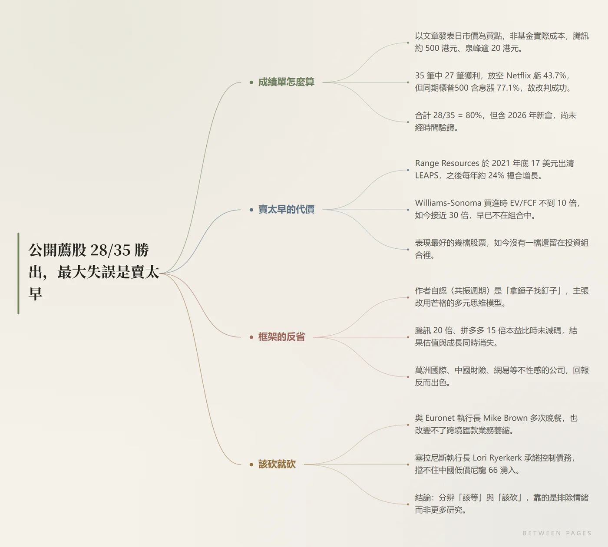

# Between Pages · 页间

> Paste a link. Get a reading, not a wall of text.

A plugin for **DeepSeek Harness** that turns any web article into **a structure mind map, bolded key points, a section-by-section reading, and a critique** — and lets you keep good sentences as polaroid sticky notes.

```
paste a link  →  ~2 s: article + mind map  →  the digest follows
```



## What it does

| | |
|---|---|
| **Read** | Extracts the main body, drops ads and comment sections. Sites that block bots (WeChat articles, etc.) fall back to a direct browser-style fetch. |
| **Map** | Renders a borderless structure mind map, with dark and light variants that follow the theme. |
| **Digest** | One-line verdict → key points (numbers bolded) → section-by-section reading (headline / condensed paragraph / margin note) → a written critique. |
| **Ask** | A chat dock sits at the bottom, answering from this article only. Facts outside the article are looked up on the web, with sources listed. |
| **Keep** | Select any sentence to pin it as a polaroid note — seven paper tints, draggable, resizable, editable. |
| **Take it away** | One click at the end copies the whole reading as Notion-ready Markdown. |

## Languages

The article page has a `简 / 繁 / EN` switch. Changing it regenerates the digest (each language is cached separately) and switches the interface copy too. Traditional Chinese uses Taiwan vocabulary; English asks for idiomatic magazine-style prose rather than literal translation.

## Install

See [install.md](install.md) — three steps: drop the folder somewhere permanent, register a `link:` dependency plus a bundle entry in your profile's `package.json`, restart Harness.

You need **Edge or Chrome** on the machine: the mind map is rendered to PNG by a headless browser.

## Layout

```
article-notion-digest/
├── index.js                 host half: tools, skill, prompt section, /article-desk/* routes
├── client.js                client half: home, stickers, article page, chat dock, language switch
├── cordis.patch.yml         bundle mount declaration
├── icon.svg                 sidebar icon
├── locale/{zh,en}.json      plugin name and description
└── lib/
    ├── extract.js           HTML → Markdown main-content extraction
    ├── mindmap.js           mind map SVG generation and PNG rendering
    └── model.js             model calls, JSON extraction and repair, token accounting
```

## Notes on how it works

**Two-phase loading.** `/article-desk/open` only fetches, extracts and draws (~2 s), so the page is readable almost immediately; `/article-desk/analyze` fills in the digest afterwards. Articles are cached per URL for ten minutes, mind map PNGs are reused from disk, and the light/dark variants render in parallel.

**Article text is treated as data.** Nothing scraped is executed as an instruction, and the system prompt says so explicitly.

**Survives session switches.** Besides browser storage, the host keeps a pointer to the current article (`%TEMP%/dsh-article-desk/session.json`), so switching conversations lands you back on the same page.

**Failures are never cached.** A failed fetch or an unparseable digest is not written to the cache, so one bad attempt is not remembered for ten minutes.

## Known limits

- Sites behind a login or aggressive bot protection may not yield a body; the plugin says so instead of guessing
- The mind map needs a local browser; without one everything else still works
- Digests are model-generated and take 30–70 s depending on the article and output length

## Privacy

Articles, digests and stickers stay on your machine (browser local storage plus a temp directory). Apart from calls to the model you configured — and an optional web lookup when a question needs outside facts — nothing is uploaded.

## License

MIT
