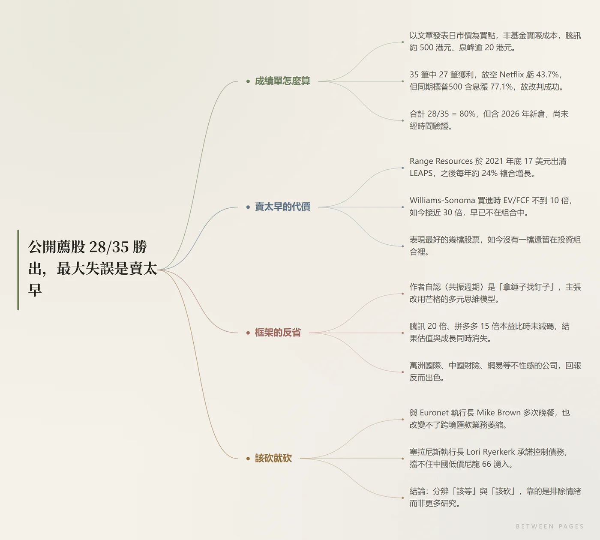

# 页间 · Between Pages

**中文** · [English](README.en.md)

> 贴一个链接，读一篇被整理好的文章。

一个 [DeepSeek Harness](https://github.com/deepseek-ai) 插件：把网页文章读成 **结构导图 + 加粗要点 + 逐段精读 + 读后评论**，并且允许你把好句子框选成拍立得便签留下来。

```
贴上链接  →  ~2 秒：正文 + 结构导图  →  解读随后补上
```

## 长什么样



导图是渲染出来的 PNG，不是文字树——深浅两套配色随主题切换，点开放大、滚轮缩放。

## 它做什么

| | |
|---|---|
| **读** | 抓正文、去广告与评论区；对反爬站点（微信公众号等）改走浏览器直连 |
| **理** | 生成一张无边框的结构导图，深浅两套配色跟随主题 |
| **析** | 一句话结论 → 要点（加粗关键数据）→ 逐段精读（重点 / 浓缩段落 / 批注）→ 读后评论 |
| **问** | 底部常驻对谈栏，只依据本文作答；涉及文章外的事实会联网检索并标明来源 |
| **存** | 框选任意一句收成拍立得便签，七种纸色、可拖动、可缩放、可改字 |
| **带走** | 文末一键复制 Notion 版 Markdown |

## 语言

文章页右上角可切换 **简 / 繁 / EN**。切换会重新生成解读（每种语言独立缓存），界面文案同步切换，繁体使用台湾用语，英文要求地道表达而非逐句直译。

## 安装

```sh
dsh plugin --profile <你的 profile> add https://github.com/Edsenpai/page-between
```

也可以手动登记，步骤见 [install.md](install.md)。

### 导图需要本机浏览器

导图是渲染出来的 PNG，靠一台 headless 浏览器完成。插件会自己找：

| 系统 | 自动查找的位置 |
| --- | --- |
| Windows | Edge / Chrome 的默认安装路径 |
| macOS | `/Applications` 下的 Edge、Chrome、Chromium、Brave |
| Linux | `/usr/bin` 下的 microsoft-edge、google-chrome、chromium，以及 `/snap/bin/chromium` |

装在别处（或者想指定某个浏览器）时，用环境变量指过去：

```sh
# macOS / Linux
export DSH_MINDMAP_BROWSER="/path/to/chrome"

# Windows (PowerShell)
$env:DSH_MINDMAP_BROWSER = "D:\path\to\chrome.exe"
```

找不到浏览器时，导图会缺失，其余功能（正文、要点、精读、评论、便签、导出）都正常。

## 目录

```
page-between/
├── index.js                 Host 半：工具、技能、提示词、/article-desk/* 路由
├── client.js                Client 半：首页、便签、文章页、对谈栏、语言切换
├── cordis.patch.yml         插件挂载声明
├── icon.svg                 侧栏图标
├── package.json             插件清单（dsh.bundle 声明）
├── locale/{zh,en}.json      插件名称与描述
├── lib/
│   ├── extract.js           HTML → Markdown 正文抽取
│   ├── mindmap.js           导图 SVG 生成与 PNG 渲染
│   └── model.js             模型调用、JSON 提取与修复、token 统计
└── docs/                    仓库配图
```

## 一些实现细节

**两段式加载。** `/article-desk/open` 只做抓取、解析、画图，约 2 秒返回，页面立刻可读；`/article-desk/analyze` 再补上解读。文章按 URL 缓存 10 分钟，导图 PNG 落盘复用，深浅两张并行渲染。

**不信任正文。** 抓下来的内容只当数据，任何「指令」都不执行；模型侧的系统提示也明确写了这一条。

**跨会话不丢。** 当前文章除了浏览器本地存储，也在宿主侧留了一份指针（`%TEMP%/dsh-article-desk/session.json`），换会话回来还停在原处。

**失败不缓存。** 抓取失败、解读解析失败都不会写进缓存，避免一次偶然的失败被记住十分钟。

## 已知限制

- 需要登录或强反爬的站点可能取不到正文，会明确提示
- 导图依赖本机浏览器；没有则只有导图缺失，其余功能正常
- 解读由模型生成，通常 30–70 秒，取决于文章与输出长度

## 隐私

文章、解读、便签都存在本机（浏览器 localStorage + 系统临时目录）。除调用你自己配置的模型（以及可选的联网检索）之外，不上传到别处。

## License

尚未指定。如果你打算让其他人自由使用，建议在仓库页面上添加一个 MIT 许可证。
